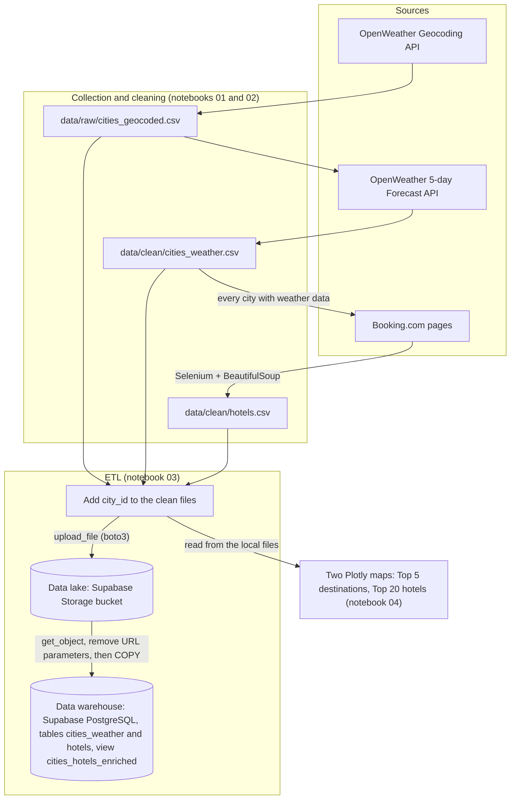

# Plan your trip with Kayak (Jedha, Bloc 1)

Kayak's marketing team wants to recommend destinations and hotels from real data. This project collects weather and hotel data for French cities, stores the clean files in a data lake, loads them into a SQL data warehouse, and shows the Top 5 destinations and the Top 20 hotels on two maps.

## Data architecture



The files are cleaned during collection. Notebook 03 adds `city_id`, builds the enriched file, uploads the three files to the data lake, reads the two source files back from it, removes the parameters from the Booking addresses and replaces the warehouse tables in one transaction. A SQL view rebuilds the enriched file, and the notebook checks that both are identical. The maps read the local clean files.

## Pipeline

| Notebook | Role | Output |
|---|---|---|
| `notebooks/01_geocode_weather.ipynb` | geocodes the cities, gets forecasts, computes `weather_score = temperature - rain_prob * 10 - wind_speed` | `data/raw/cities_geocoded.csv`, `data/clean/cities_weather.csv` |
| `notebooks/02_booking_scraping.ipynb` | scrapes the first 15 hotels of the Booking.com results page for every city, then each hotel's coordinates and description; reports the distance between hotels and their city | `data/clean/hotels.csv`, `data/raw/hotels_distance_report.csv` |
| `notebooks/03_etl_s3_rds.ipynb` | adds `city_id`, builds the enriched file, uploads to the data lake, loads the warehouse with `COPY`, checks the row counts and the view | bucket files; tables `cities_weather`, `hotels`; view `cities_hotels_enriched` |
| `notebooks/04_visualization.ipynb` | builds the two maps from the clean files | 2 Plotly maps |

## Data

- `cities_weather.csv`: 34 cities, 9 columns.
- `hotels.csv`: 511 hotels, 15 per city and 16 for St Malo, 9 columns.
- `cities_hotels_enriched.csv`: 511 rows, 16 columns, hotels joined to the weather of their city.
- Top 5 of the collection of 31 October 2026: Bormes les Mimosas, Bayonne, Biarritz, Cassis, Collioure.
- The weather data is a snapshot: rerunning notebook 01 can change the Top 5.
- The collected data is in the repository, in `kayak-projecct/data/`, so notebooks 03 and 04 can run from a fresh clone. The collection can be run again with notebooks 01 and 02.

## Configuration

Create `kayak-projecct/.env`, which is listed in `.gitignore`, with these variables:

```
OPENWEATHER_API_KEY=
S3_ENDPOINT_URL=
S3_REGION=
S3_ACCESS_KEY_ID=
S3_SECRET_ACCESS_KEY=
S3_BUCKET=
DB_HOST=
DB_PORT=
DB_NAME=
DB_USER=
DB_PASSWORD=
```

`OPENWEATHER_API_KEY` is only used by notebook 01. The `S3_` and `DB_` variables are used by notebook 03. Use the Supabase session pooler for the database (port 5432).

## Run the pipeline

Install the libraries:

```bash
pip install pandas numpy requests python-dotenv beautifulsoup4 selenium webdriver-manager boto3 psycopg2-binary plotly jupyter
```

Go to the notebooks folder from `01_kayak/`:

```bash
cd kayak-projecct/notebooks
```

To reload the data lake and the warehouse from the existing clean files, run notebook 03 only. The result is the same on every run: the tables are replaced, not appended to.

```bash
jupyter nbconvert --to notebook --execute --inplace 03_etl_s3_rds.ipynb
```

To rebuild the maps:

```bash
jupyter nbconvert --to notebook --execute --inplace 04_visualization.ipynb
```

To collect everything again, delete `hotels_cards.csv`, `hotels_search_log.csv` and `hotels_details.csv` from `data/raw/`, run notebooks 01 and 02, then 03 and 04. This calls the APIs and scrapes Booking.com again, so it changes the forecasts and can change the Top 5 and the hotels. Notebook 02 needs Chrome and took about 1 h 55 on 31 October 2026. If it stops, running it again continues after the last hotel saved. It stops at once if Booking shows a CAPTCHA or a block.

If a boto3 call fails with `CERTIFICATE_VERIFY_FAILED` while an antivirus inspects HTTPS traffic, add an exception for the storage address in the antivirus.

## Deviations from the brief

- **Hosting:** Supabase replaces AWS, because the AWS account used during the course is no longer accessible. The data lake is a Supabase Storage bucket with an S3-compatible API, not Amazon S3. The warehouse is Supabase PostgreSQL, not RDS.
- **Cities:** 34 of the 35 cities are covered. The geocoder returned no coordinates for Gorges du Verdon, so this destination has no weather data.
- **Forecast horizon:** the OpenWeather Forecast API covers 5 days, so the ranking is based on 5 days instead of the 7 in the brief.
- **Geocoding:** the coordinates come from the OpenWeather Geocoding API. The brief suggested Nominatim.
- **Files:** the data lake holds the single enriched file requested, plus its two source files, one for weather and one for hotels, linked by `city_id`.
- **Application:** the brief speaks of an application. This project delivers a pipeline that is run by hand, notebook by notebook.
- **Names:** `03_etl_s3_rds.ipynb` keeps its name from the first AWS version, but it does not use RDS.
